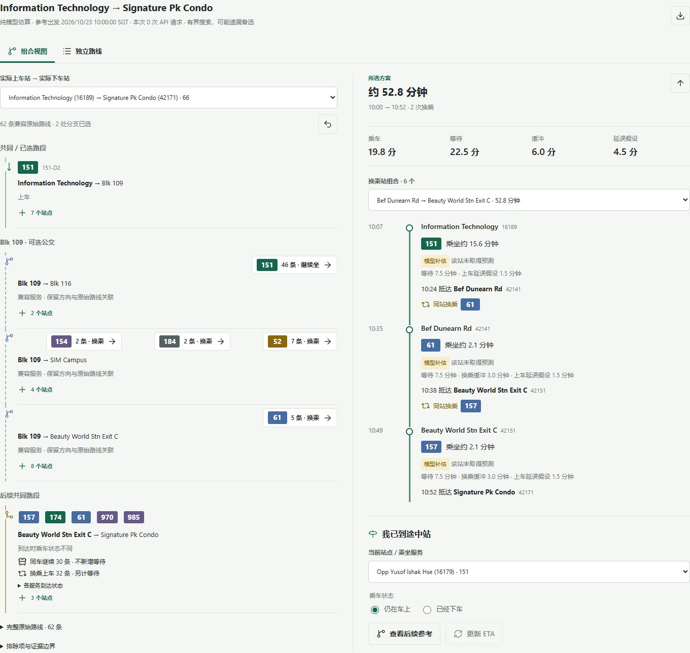

# SG-Transit-Reliability

**TL;DR：一个公交路线研究原型，不只列出路线，还展示共同路段、备选服务，以及继续坐和换车的区别。**

本地离线可用，支持声明路网内的自选公交站与附近候选站。
重点是路线解释和可复现实验，不是全岛导航，也不以战胜 Google Maps / Citymapper 为验收条件。

- **2 个原始案例**，另有 97 路双向导入路网用于自选站点验证。
- **7,212 条拓扑候选**：Blk 18 → CDE 指定局部网络与约束下的结果，不代表每次查询数量。
- **10,000 次模拟 / 策略**：合成实验采用独立选优、评估种子；不是实地乘车次数。
- 组合图只整理原始候选，不增加可执行路线，不改变路线时间或换乘数。

## 快速开始

需要 Python 3.10+。从源码仓库根目录运行：

~~~powershell
git clone https://github.com/potatoyyz6-coder/SGTransit.git
cd SGTransit
python -m venv .venv
.\.venv\Scripts\python -m pip install -e ".[dev]"
.\.venv\Scripts\python -m experiments.local_app
~~~

macOS / Linux 使用 `.venv/bin/python` 对应路径。
打开 [本机界面](http://127.0.0.1:8765)。端口已占用可加 `--port 8766`。
安装依赖需要联网；离线规划无需密钥。
只监听本机，不部署公共服务、不自动采样、不读取定位。以源码运行，不是独立导航安装包。

快捷案例以运行时刻检查历史运营窗口，深夜可能没有默认方案。
勾选“自选站点与附近候选”可指定参考时刻；
例如选 Information Technology 网络、中心站 16189 → 42171、半径 0、
参考 2026-10-23 10:00，可查看固定离线示例。日期不是实时班次查询。

## 共同路段与备选



截图使用固定的 2026-10-23 10:00 SGT 模型参考，
不是 Google 截图、实时到站或真实乘车结果。功能属于 **Unreleased 源码开发版本**，尚未创建新的版本 Release。

组合视图使用全部默认参考候选，不只是首页代表路线。
选择实际起终点后沿共同前段展开分支，相同站序的可选服务并列展示；
共同后段保留原路线关联，每次选择都会收窄兼容路线集合，不任意拼接不同路线。

“继续乘坐 61”与“换乘 61”保留各自历史。未选定的组合没有统一总时间。
“采用此路线”选择已有完整路线，打开原有时间分项和途中参考。
每页最多 60 个图节点、每处分支 8 项；展开和分页不删除底层候选。

[案例与展示原理](docs/ROUTE_COMBINATIONS.md) ·
[自选站点与接驳限制](docs/STATION_PLANNING.md) ·
[最新本地验收](docs/COMBINATIONS_VERIFICATION.md)

## 复现实验

以下 `python` 指安装了项目依赖的同一个环境：

```powershell
python -m examples.demo
python -m experiments.blk18_cde_case
python -m experiments.run_all
python -m experiments.combinations_check
python -m pytest -q -p no:cacheprovider
python -m tools.release_check
```

分别运行合成示例、真实拓扑 / 假设时间案例、三组合成 Monte Carlo、
组合一致性与性能检查、离线测试、发布文件扫描。
测试阻止外部网络；API 行为用假数据，不使用真实密钥。

[完整实验与 CLI 指南](docs/EXPERIMENT_GUIDE.md) 包含算法、案例报告、参数和数据来源。
[Central Library 历史对比复现](docs/EXPERIMENT_GUIDE.md#central-library-到-jurong-east-的验证)
会先生成被忽略的 `results/central_library_jurong_east.json`，再运行比较。
新克隆无需已有结果文件，也不需要再次查询 Google。

## 证据与限制

- **真实拓扑不等于真实耗时**：站序来自带来源哈希的历史 LTA 数据；乘车与等待使用明确假设。
- **覆盖有限**：有向局部路网，不承诺全岛完整性；搜索预算和缺口随结果返回。
- **步行未知不作零**：附近站按直线距离发现，不保证可跨道路或围墙到达；接驳留空则全程时间未知。
- **模型与实测分开**：ETA 是预测，不是实际到站；尚无校准后的赶车概率或实际提速结论。
- **组合不是新策略**：展示不改变搜索或调用碎片索引；合成可靠性实验与本地参考是不同评估层。
- 真实距离票价尚未实现；历史私人 ETA 记录不发布，相关回放需要自己的兼容记录。

审阅后的小型摘要报告和项目自制图片进入 Git；
原始采样、密钥、完整候选 CSV/JSON 和大型模拟数组默认忽略，按命令重建。

## 协作与项目资料

由作者与 **OpenAI Codex 协作开发**：作者负责需求定义、候选走法反馈和实验方向；
Codex 协助建模、实现、测试与文档。不是把 AI 辅助工作描述为独立手写成果。

[简历项目说明与分工](docs/RESUME_PROJECT.md) · [下一阶段状态](docs/NEXT_STEPS.md) ·
[历史任务板（归档）](ROUTE_MAP.md) · [CHANGELOG](CHANGELOG.md) ·
[发布流程](docs/RELEASING.md) · [历史发布验证](docs/RELEASE_VERIFICATION.md)

源码更新与版本 Release 分开管理；当前源码状态以仓库分支、提交和 CI 记录为准。
本轮源码整合不创建新的 GitHub Release 或版本标签。

## 数据与发布边界

代码采用 [MIT](LICENSE)，第三方数据与图标见 [NOTICE](NOTICE.md)。
[Agent 边界](AGENTS.md) 和 [完整数据边界](docs/EXPERIMENT_GUIDE.md#legal-data-and-attribution-boundaries)
适用于代码、文档与生成物。

密钥仅保留在环境变量 / 本地秘密存储，不上传凭证、认证头、私人采样或 Google 截图。
Google 仅作最小手工字段参考，不抓取、批量下载或用于训练替代数据集。
不收集乘客身份与位置轨迹，不提供公共、安全关键或保证到达的导航。
公共部署、商业化、新第三方数据与个人数据使用需另行法律 / 隐私审查。

> This project is an independent research project and is not affiliated with,
> endorsed by, or sponsored by the Land Transport Authority of Singapore,
> Google, or Citymapper.
