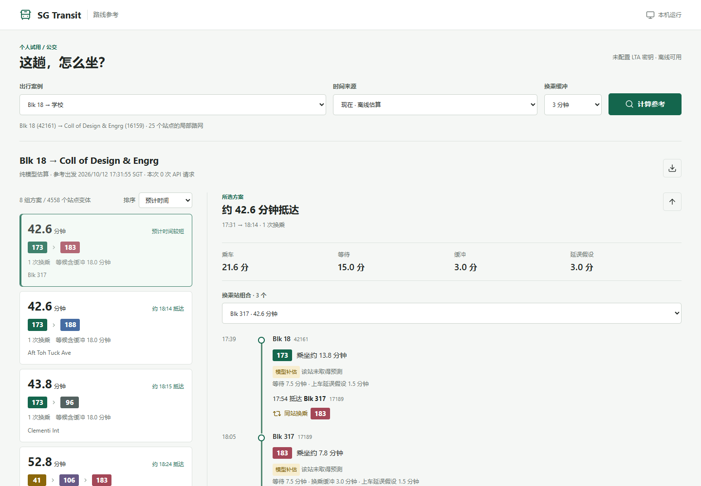

# SG-Transit-Reliability

一个可复现的公交候选路线与沿途换乘策略实验项目。当前首先回答：

> 从起点到终点有哪些合理的可能走法？沿途哪些站可以继续乘坐、换车或保留备选，让乘客获得有依据但不保证兑现的出行参考？

项目不以必须超过 Google Maps 或 Citymapper 为成功条件，也不要求先完成实地乘车
或到站误差校准才能输出候选。现有代码包含合成实验、历史静态路网和 LTA ETA
离线分析；这些证据的用途不同，不能混为实际出行保证。

## 快速开始

仓库地址：[potatoyyz6-coder/SGTransit](https://github.com/potatoyyz6-coder/SGTransit)。
当前为私有仓库，需要获得访问权限才能克隆：

```powershell
git clone https://github.com/potatoyyz6-coder/SGTransit.git
cd SGTransit
```

需要 Python 3.10 或更新版本。从下载或克隆后的**仓库根目录**运行：

```powershell
python -m venv .venv
.\.venv\Scripts\python -m pip install -e ".[dev]"
.\.venv\Scripts\python -m experiments.local_app
```

macOS / Linux 使用 `.venv/bin/python` 替代 `.\.venv\Scripts\python`。
打开 [本地界面](http://127.0.0.1:8765)。无需密钥即可离线查询两个案例；
Python 安装依赖时需要联网，之后离线模式不调用 API。
本版以源码仓库为运行入口，不是安装 wheel 后即可使用的完整导航应用。



截图展示模型参考，不是实际乘车时间或当前服务保证。

```powershell
.\.venv\Scripts\python -m examples.demo
.\.venv\Scripts\python -m experiments.blk18_cde_case
.\.venv\Scripts\python -m pytest -q -p no:cacheprovider
```

第一条运行纯合成实验；第二条生成学校案例的完整候选与报告；第三条运行测试。
测试自动阻止外部网络，API 路径使用假数据。历史私人 ETA 原始记录不随仓库发布，
相关回放命令需要自己的兼容记录；缺失历史快照不会妨碍离线界面。
下文出现 `python` 时指安装了本项目依赖的同一个环境。

代码采用 [MIT](LICENSE)，数据和图标适用各自的 [来源与许可说明](NOTICE.md)。
[发布检查](docs/RELEASING.md) · [版本记录](CHANGELOG.md) ·
[发布前验证](docs/RELEASE_VERIFICATION.md)。大体积生成文件不进入 Git，按对应命令重建。

> This project is an independent research project and is not affiliated with,
> endorsed by, or sponsored by the Land Transport Authority of Singapore,
> Google, or Citymapper.

## 本地操作界面

在仓库目录启动，然后在**同一台电脑**的浏览器打开 http://127.0.0.1:8765 ：

```powershell
# 在当前仓库根目录运行
$env:PYTHONPATH = "$PWD\src"
python -m experiments.local_app
```

端口被占用时可加 `--port 8766`。服务只监听 `127.0.0.1`，不对局域网或公网开放；
不需要 Node.js、CDN、登录或定位权限。关闭终端服务即停止，后台没有定时采集任务。

1. 选择 **Blk 18 → 学校** 或 **Information Technology → Signature Pk**。
2. 选择“现在 · 离线估算”直接查看模型参考，或“现在 · 查询 LTA ETA”确认后获取一轮预测。
   Blk 18 案例也可查看本地已有的 10 月 8 日历史快照；没有该文件时此选项禁用。
3. 点击候选路线，查看逐段站点、时间来源，以及同服务序列的其他换乘站组合。
4. 到达途中站后，在所选路线中手动选择站点，指定“仍在车上”或“已经下车”，
   查看后续参考，或明确确认后更新一轮 ETA。不会自动追踪位置。

每轮采集每站一次：学校案例最多 25 次、回家案例最多 47 次；两轮至少间隔 60 秒，
90 秒后不启动新请求，每个在途请求最多 6 秒；失败立即停止，不重试。
密钥只从后端进程的 `LTA_DATAMALL_API_KEY` 读取，页面不接收或展示密钥。
重新设置用户环境变量后，应重启启动界面的终端进程。
没有密钥仍能使用离线参考；实时请求失败或预测缺失时，页面保留候选并标注模型补估。

回家案例复用已有目的地方向的有界候选搜索，可能遗漏备选；学校案例仍使用原来的
7,212 条局部拓扑候选。历史运营窗口、方向、换乘上限和时间约束继续生效。
途中参考只比较与已选乘车前缀一致的候选，保留已使用服务与已经过站点，
同车继续不重复等待或计算新换乘；已下车后的等候起点不会因刷新而重置。
这不是完整全岛导航，也不声称预测已兑现。

原始 API 响应保存到已忽略的 `data/recorded/raw/local_ui/`，记录来源、采集时间和静态数据哈希，
不保存手动选定的位置、乘车状态或个人身份。当前路线状态只保留在内存，最多三个查询，
三小时后不再可用。可手动导出当前候选摘要；导出不包含密钥或后台会话标识。
历史快照的途中选择只是历史推演，不能直接刷新成今天的行程，需要先重新查询现在出发。

[界面验证记录](results/local_ui_verification.md)

## 当前目标与验收

- 在声明的路网和搜索预算内找到方向正确、站序连通的候选，并说明覆盖范围和截断情况。
- 比较继续乘坐与沿途换乘，保留有用的直达、少换乘、少等车和多备选走法，不强制经过大站。
- 同一辆车继续坐不重复计算等待和换乘；公交数量多不自动等于更好的方案。
- 时间可以是 ETA 或模型估计，但必须标明来源、预测时刻和假设；没有依据时标记未知。
- 缺少车辆身份匹配或实际到站记录，不等于没有可行路线。静态可达、运营时段适用、
  预测下可衔接以及已观测到的实际结果分开报告，不因回放未知而抹去拓扑候选。
- 历史站序只能支持历史网络中的可能解；不能将未知的当前运营状态写成当前保证可乘。

评估可靠性仍有价值，但属于后续改进：可以比较模型中的平均时间、等待时间、
P90/P95 和敏感性，不把模型概率当成已校准的赶车成功率。Google 手工参考和
匿名到站事件验证均为可选，不是候选路线实验的前置条件。

当前仍是独立研究和本地实验，不因提供参考的定位而自动转为公开导航服务。
已有实验结果和局限继续保留，包括无收益或证据不足的结果。

## Blk 18 到学校：离线参考案例

新增独立入口，自动搜索 Blk 18（42161）到 Coll of Design & Engrg（16159）的走法。
路网包含 25 个站点、9 个方向路段，保留全部中间站，可在共同站点换乘，
不强制经过预先指定的换乘大站。搜索最多 5 次换乘，保留完整候选和预算状态。

```powershell
python -m experiments.blk18_cde_case
```

普通工作日 10:00 的历史运营窗口参考下，搜索找到 7,212 条拓扑候选；
其中包含 106A 的限时方案不进入默认参考池，剩下 4,558 条。首页合并展示
8 个不同服务序列，并可展开同一序列的其他换乘站。完整结果不会因展示筛选而删除。

| 示例服务序列 | 模型平均总时间 | 换乘次数 |
| --- | ---: | ---: |
| 173 → 183 / 188 | 42.60 分钟 | 1 |
| 173 → 96，经 Clementi Int | 43.80 分钟 | 1 |
| 41 → 106 → 183 / 96 | 52.80 分钟 | 2 |

这些不是实时 ETA：乘车按 20 km/h、每原始路段至少 0.5 分钟估算，
每次上车平均等待 7.5 分钟、平均延误 1.5 分钟，每次换乘另加 3 分钟缓冲。
参数可通过 `--speed-kmh`、`--headway`、`--delay-max`、`--transfer-buffer` 修改。
`--day` 与 `--departure` 仅用于历史运营窗口检查，不提供某天实际时刻表。

五个合成局部 ETA 示例展示了：继续坐 173/106/183 不重复等待；直达车很快来时
可以等直达车，而直达车较晚、接驳车较早时，可以先坐 105/106 后续换乘。
局部评分使用所有默认合格候选，不只用首页的 8 个组合，不输出未经校准的赶车概率。

[路线及沿途选择报告](results/blk18_cde_reference/report.md) ·
[服务与共同站点结构图](results/blk18_cde_reference/routes.png)。
完整候选在同目录的 `candidates.csv` 与 `reference.json`。该入口离线运行，
不调用 API、不创建采集任务，也不改动历史 ETA 回放。

另经单独授权，于 2026-10-08 11:20 对同一案例的 25 个站点各采集一次 LTA ETA，
25 次全部成功，任务已停止。[单轮采样结果](results/blk18_cde_reference/snapshot_20261008_1120.md)
独立保存；它没有将上表的离线模型时间改写为实时行程时间。

### 已保存快照的出发参考

```powershell
python -m experiments.blk18_snapshot_reference
```

该入口读取本地保存的 2026-10-08 快照，不调用 API。共同出发/信息截止时间采用
最后一站响应收到的 **11:20:01.741685（新加坡时间）**，不把尚未收到的数据提前使用。
第一程和后续换乘都选择预计准备好上车之后的匹配 ETA；已超出预测范围或缺少预测时，
保留路线并明确回退到平均等待模型。方向用历史线路端点及站点访问次序匹配，
不通过 `NextBus` 序号跨站认定同一辆车。

| 服务序列 | 换乘站示例 | 快照 + 模型参考 | 同路线纯模型 |
| --- | --- | ---: | ---: |
| 173 → 188 | Aft Clementi Fire Stn（20109） | 40.29 分钟 | 42.60 分钟 |
| 173 → 183 | Aft Toh Tuck Ave（28019） | 40.50 分钟 | 42.60 分钟 |
| 173 → 96 | Clementi Int（17009） | 41.72 分钟 | 43.80 分钟 |
| 41 → 106 → 183 / 96 | Depot、Blk 365 | 51.05 分钟 | 52.80 分钟 |

两列的差值不是已实现的提速。前两条只差约 13 秒，不能解释为实际优劣。
所有乘车时间及每次上车的 1.5 分钟平均延误仍是假设，后者不是校准后的 ETA 误差。
`173 → 183` 此处选中的 183 预测标记为 `Monitored=False`；`173 → 96` 的第二程
已超出快照范围；106 缺少预测。这些差异均在逐段报告中标明，不伪装成完整实测时间。

报告比较预计最快、最少换乘、最少站外等待三个偏好。本次它们选中了同一方案，
不会为制造差异而强行推荐不同路线。沿途备选使用全部合格候选：例如在 Depot
继续坐 173，或在 Aft Toh Tuck Ave 选择 183/188/105/106，并列出后续总时间和等待来源。
这些是从出发快照推演的选择，不是抵达中途站时重新取得的实时信息，也不包含赶车概率。

[快照出发参考报告](results/blk18_cde_snapshot_20261008_1120/report.md) ·
[验证记录](results/blk18_cde_snapshot_20261008_1120/verification.md)。
同目录 `reference.json` 保存全部候选、换乘站变体、参数、来源哈希和逐段预测记录引用。
`--snapshot` 可指定兼容的本地记录，`--output` 可指定独立输出目录；
速度、headway、延误和换乘缓冲可配置。默认原始快照被 Git 忽略，缺失时不会自动下载；
无密钥环境仍可运行使用合成快照的 `tests/test_snapshot_reference.py`。
原来的离线报告和严格 ETA 回放保持不变。

## 2026-10-07 实测 ETA 离线分析

09:55 至 11:54（新加坡时间）共保存 960 次成功响应，8 个站点各 120 次。
10:00、10:15、10:30、10:45 的 32 个出发时刻/站点组合都有新鲜快照。
这些是 **LTA 到站预测记录，不是实际到站真值**；离线分析没有新增 API 调用。

在 Blk 109 的 120 个监测快照中，假设当时到站并预留 3 分钟换乘，
只等 61 的平均预测等待为 10.98 分钟，允许 61/52/75/184 为 4.99 分钟。
预测等待超过 10 分钟的快照分别为 65 和 1 个。这些快照彼此相关，
**不能解释为真实长等待概率或全程提速**；其他服务还可能需要再次换乘。

四个出发时刻均回放了三条预先指定固定路线、先到先坐策略和现有下游评分策略。
主场景（3 分钟换乘缓冲）中，下游评分策略四次均因证据不足而无法完成条件回放，
不是四次换乘失败，也不能只拿可完成的其他路线来宣称其更优。
同时保留换乘缓冲和 ETA 偏移的全部敏感性结果，不将重复回放当独立样本。

额外检查了现有反向搜索：在本次投影小网络、最多两次换乘的范围内，完整搜索有
21 条候选、31 次扩展；优先枢纽搜索有 18 条候选、29 次扩展，并明确标记截断。
两者本来就使用反向乘车时间下界；这个结果不证明新增“倒水”算法或全程质量提升。
枢纽筛选没有用于删减本轮 ETA 回放候选。

```powershell
python -m experiments.analyze_eta_window
```

需要本地保留的原始记录；记录不随仓库公开。[完整分析与局限](results/eta_20261007_1000/analysis.md)。

## 局部真实站序随机起终点实验

已在本地历史静态数据组成的96站、16个方向路段上，固定随机种子抽取20对起终点：
7对最少直达、7对最少一次换乘、6对最少两次换乘；另保留Information Technology
到Signature Pk Condo作为指定案例。程序自动寻找换乘方案，不需要人工提供路线。
所有查询均使用同一套受限换乘节点；它们不是全岛或整个区域的最优路线搜索。

默认每例256个训练样本、1,000个独立测试样本、64个前瞻模型样本。20对随机起终点中，
12对只有一条合法候选；按各模式主要指标比较，动态策略在3对改善，17对持平。
样本集中于已选局部走廊，不能把这个比例推广为全新加坡效果。

回家案例的94条候选包含在Blk 109换61、52、75、184，经Pei Hwa继续换车的分支。
坐61可以不下车到达目的地，继续乘坐不会重复计等待和换乘。模拟结果如下：

| 策略 | 平均总时间 | P95 | 平均站台等待 |
| --- | ---: | ---: | ---: |
| 训练选定的固定最快路线 | 40.58 | 51.17 | 14.79 |
| 动态尽快到达 | 40.28 | 50.50 | 14.16 |
| 动态少等车 | 41.14 | 53.09 | 11.42 |
| 动态稳妥到达 | 40.58 | 51.17 | 14.74 |

单位为分钟。少等车减少了等待，但增加了总时间和尾部时间；稳妥模式没有明显收益。
另外保留了回家案例的发车间隔、延误、换乘缓冲和相关到站压力测试，包括负面结果。
数据是**历史站序 + 假设时长**，不是实际出行预测，没有新调用LTA或Google API。
不建模跨站步行。换乘节点限制、搜索预算、采样清单及每条方案的服务和上下车站均在报告中。

```powershell
python -m experiments.local_routes
```

[结果概览](results/local_routes_20261007/overview.md) ·
[全部路线和结果](results/local_routes_20261007/report.md)

## 2026-10-06 偏好与时间分布前瞻实验

现在三种偏好会实际改变选路，而不只是改变展示指标：

- **尽快到达**：最小化模型平均总时间。
- **少等车**：总时间 + 2 × 站台等待 + 3 × 换乘次数。等待已计入总时间，
  因此这里的等待总权重为3；权重可配置，不是从真人偏好学习出来的。
- **稳妥到达**：最小化模型P95，再以平均时间和换乘次数打破平局。

固定路线使用独立训练样本选定。动态版本在当前可乘班次基础上，模拟每个合法后续
路线的时间／等待分布，先选方案、执行第一段，再在下一站重新决策。
它不会读取测试样本中的未来结果，也不会在每次模拟中事后挑最好的后续路线。
后续等待与延误仍采用独立平稳模型；这是有搜索预算的分布前瞻启发式，
**不是全局最优或保证全程P95更低的动态规划**。

原有八个案例全部保留，并增加一个等车与乘车时间取舍的对照。默认每例2,000个训练
样本、10,000个测试样本，每次前瞻使用另外256个模型样本。主要结果：

| 合成案例 | 尽快到达 | 另一偏好 | 取舍 |
| --- | --- | --- | --- |
| 平均与尾部冲突 | 平均21.98，P95 39.97分钟 | 稳妥：平均26.01，P95 27.80分钟 | 平均多4.03分钟，P95低12.18分钟 |
| 等车与乘车取舍 | 等待6.00，总时间14.39分钟 | 少等车：等待2.32，总时间16.24分钟 | 少等3.68分钟，多花1.84分钟 |
| 紧张衔接 | 等待4.45，总时间33.83分钟 | 少等车：等待3.02，总时间34.85分钟 | 单次换乘等待超过10分钟的模型概率从4.27%到0.04% |

同步到站与只有一条公交的无选择案例仍无多分支收益。负面结果也保留：紧张衔接中
新稳妥模式的P95为37.68分钟，略高于旧评分策略的37.62分钟；少等车也可能增加换乘。
站台等待不含单独记账的换乘缓冲，不能把这些数值当作经过验证的户外热暴露或实际赶车概率。

```powershell
python -m experiments.preference_benchmark
# 修改偏好权重，不调用API
python -m experiments.preference_benchmark --extra-wait-weight 3 --transfer-penalty 5 --output results/preference_custom
```

见[偏好实验报告](results/preference_benchmark/report.md)和
[取舍图](results/preference_benchmark/preferences.png)。配置、训练选择、全部测试结果、
配对置信区间和逐样本数据保存在独立目录，旧实验结果未覆盖。
此处概率与置信区间只描述合成模型，不是校准后的真实出行预测。

## 2026-10-06 公平基准与反例实验

新增纯离线基准，**不调用 LTA 或 Google API，不使用 Google 结果拟合参数**。
固定路线、先到先上、现有后续路径评分策略共用路网、候选集合、随机交通条件和执行器。
程序会验证共享路径重组没有给动态策略增加额外候选；固定路线用2,000个训练样本选定，
再用另外10,000个测试样本比较，不能事后按每次模拟结果挑最快路线。
另外保留按训练P95选择的固定路线，防止只与平均时间基线比较而夸大尾部收益。

八种合成情景覆盖独立到站、同步到站、独立／共同延误、紧张衔接、多绕路／多换乘、
平均与尾部冲突，以及只有一条公交的无选择对照。默认实验结果包括：

- **独立备选服务**：固定平均时间基线P95为43.16分钟，多分支为34.49分钟；
  单次换乘等待超过10分钟的模型概率从约50%降到约6%。此例先到先上与评分策略相同。
- **同步到站**：四条线路的多分支收益消失，说明线路数量不等于独立乘车机会数量。
- **绕路与换乘代价**：先到先上平均26.15分钟，评分策略与合理固定路线均为17.98分钟。
- **明确反例**：评分策略平均21.98分钟、P95为39.97分钟；按P95选的固定路线
  平均26.01分钟、P95为27.80分钟。当前策略不是P95优化器，平均更快不代表更可靠。

等待时间不含单独记账的换乘缓冲；未完成样本不丢弃，也不填成成功。
所有概率和置信区间都只描述合成模型及其抽样误差，**不是实际赶车概率或真实出行预测**。
共同延误只是压力测试中的相关随机成本，不是经过验证的道路拥堵或公交串车模型。

安装后在项目根目录运行：

```powershell
python -m experiments.fair_benchmark
```

输出[完整报告](results/fair_benchmark/report.md)、均值/P95图、汇总CSV、
逐样本NPZ以及包含候选、训练分数、种子、源码哈希和配对置信区间的JSON。
也可用 `--samples 100 --training-samples 100 --bootstrap-samples 30 --output results/fair_smoke`
做快速检查。旧的真实ETA条件回放保留如下，不与这套合成实验混为实测结果。

## 2026-10-04 14:30 ETA 条件回放

本次11站采集共1,125次成功响应、1次失败。主采集在15:43因API错误停止，
此前各站约每分钟一条记录，无超过90秒的中途断档。原始记录仅保存在被Git忽略的
`data/recorded/raw/`；清洗关联和参数分开保存，不包含认证头或密钥。

已实现因果回放：每次决策只使用当时收到的ETA，匹配歧义和缺失不补成成功行程。
共享后续路径策略已接入原有 `SharedSuffixPolicy.update`；它当前优化平稳假设下的
预计剩余时间与换乘惩罚，**不是已校准的P95或赶车概率优化器**。

在3分钟换乘缓冲、零到站偏移的条件模型中：

| 策略 | 模型用时 | 换乘次数 | 最长单次换乘等待 |
| --- | ---: | ---: | ---: |
| 原有局部评分，151到Blk 109转61并留在车上 | 40.27分钟 | 1 | 11.47分钟 |
| 先到先上，151转52、再转157 | 45.50分钟 | 2 | 9.02分钟 |
| 固定95转970 | 60.30分钟 | 1 | 12.00分钟 |
| 固定151步行转174 | 51.76分钟 | 1 | 12.60分钟 |
| 固定151到Blk 116转61 | 未知 | 未完成 | 未知 |

这是“把连续ETA预测作为模拟到站事件”的条件结果，**不是实际乘车时间或比Google
更快的证明**。两条151转61的换乘站不同。未知方案不能当失败样本，也不能忽略后
仅比较成功方案。9组敏感性情景不是9次独立实测，不能据此计算概率或P95。
步行5分钟仅为用户提供参考中的情景输入，不代表验证过的人行路线。

```powershell
python -m experiments.replay_eta_pilot
# 可单独设定长等待阈值和模型换乘惩罚；不调用API
python -m experiments.replay_eta_pilot --long-wait-minutes 8 --transfer-penalty 5 --output results/pei_hwa_threshold_8
```

详细假设、记录覆盖、证据链和局限见
[实验记录](results/pei_hwa_20261004_1430/report.md)与
[条件回放报告](results/pei_hwa_20261004_1430/replay.md)。现有记录不能独立验证ETA误差、
实际赶车成功率或长等待概率；真实校准仍需要独立的到站/离站结果及多个行程事件。

## 2026-10-04 16:00 Google 人工参考

最新详细时刻另存于 `data/validation/google_pei_hwa_20261004_1600_details.json`，
按此版本总时间为 48、52、63、65 分钟；其中第一条的 48 分钟由 16:00 至 16:48 推算。
151→61 在 42141 换乘，95→970 在 11261 换乘。这两条在最新文本中没有步行段，
替代了早期总览中“末段步行尚不清楚”的判断，原始观察仍保留。
已用相同静态来源延长 95 至 11261，并按确切换乘站运行 10,000 次模拟；
详见 `results/pei_hwa_20261004_details/report.md`，复现命令为
`python -m experiments.pei_hwa_details`。所有时间假设未用 Google 结果拟合，
均匀初始等待与 Google 指定班次的等待不相同，不能把时长差称为算法收益。
另两条涉及步行，仍不声称已覆盖完整行程。

以下是保留的早期总览记录，并非最新详细时刻：
用户曾提供四条建议：151→61（53 分钟）、151→步行→174（57 分钟）、
95→970（67 分钟）、96→173（67 分钟）。这里只存少量人工观察字段，不保存截图。
日期由用户提供，截图显示星期日；裁剪图没有完整日期或目的地信息。

新对照位于 `results/pei_hwa_20261004_1600/report.md`，可用
`python -m experiments.compare_pei_hwa_reference` 重新生成，无需 API。
其中模型数据复用 `results/pei_hwa_20261001/experiment.json` 的平稳等待模型，
没有改写旧实验日期，也不是 10 月 4 日的周日班次预测。
四条 Google 路线均显示末段步行，换乘站和最后下车站尚待确认；现阶段不计算
“比 Google 快多少”。151→步行→174 的步行连接及 96→173 尚未被模型覆盖。

## 2026-09-28 日间 API 对比

2026-09-28 新加坡时间 10:01-10:12，对四个站点采集 12 轮 LTA Bus Arrival v3
快照；从五条线路各至少 2 个到站间隔估计 headway，更新路网后
运行 10,000 次模拟。在 10:00 的同一路网、同一随机实验中，
固定最短时间路线平均 53.17 分钟、P95 61.07 分钟；
末段可乘 105 或 183 的多分支策略平均 52.12 分钟、P95 59.99 分钟。
这些是**由 API 发车间隔校准的模拟预测**，不是实际乘车结果；乘车时长仍是估计。
完整方法、方向核对、可复现命令和 16:00 外推与 Google 手工估计的
非同口径对照见 `results/lta_daytime_comparison_20260928.md`。

新案例：Information Technology (16189) 到 Signature Pk Condo (42171)，
2026-09-28 16:00。本次中午 ETA 校准的同站换乘子集最终选择 151→61；
固定基线与可靠性策略均为平均 40.62 分钟、P95 51.00 分钟，没有多分支收益。
此结论只适用于当时最多一次换乘、仅含少量线路的子集，不包括经 Pei Hwa
多次换乘的候选，不能推断该区域不存在多分支收益。
这不是比 Google 的 50 分钟更快的实测证据。详情和复现命令见
`results/information_technology_signature_20260928.md`。

## 安装与测试

```powershell
python -m pip install -e ".[dev]"
python -m pytest -q
```

## 运行第四阶段实验

```powershell
python -m experiments.run_all
```

每个场景运行 10,000 次 Monte Carlo，并写入 `results/`：

- `*.summary.json`：参数、候选路线、策略摘要和置信区间；
- `*.samples.csv`：每个样本的行程、等待、失败和分支信息；
- `*.report.md`：自动生成的实验摘要；
- `*.png`：均值、P90/P95、等待分布、失败率和网络/策略图。

选择策略使用独立的 `selection_seed`，最终评估使用 held-out `evaluation_seed`，避免用同一批随机样本挑选又评价策略。实验还会报告共享公交相位的压力测试结果。

## 命令行规划

对一个 JSON 网络运行规划：

```powershell
python -m sg_transit plan `
  --network data/real/network.json `
  --origin 16181 `
  --destination 28009 `
  --departure 2026-09-28T16:00:00+08:00 `
  --output results/demo_plan.json `
  --samples 10000 `
  --seed 100 `
  --selection-seed 7 `
  --selection-samples 512
```

`plan` 会冻结网络 SHA256、候选路线、策略树、随机种子和样本 CSV。查看网络中的站点：

```powershell
python -m sg_transit stops --network data/real/network.json --query "Ctrl Lib"
```

## 反向候选与共享后续结构实验

新增实验模式与原有 `plan` 分开，先在小路网验证，不改变已有报告的算法口径。
范围是公交站到公交站：计入等车、乘车和同站换乘缓冲，不依赖校园步行地图。

```powershell
# 在当前仓库根目录运行
python -m pip install -e ".[dev]"
python -m experiments.corridor_search
```

报告位于 `results/corridor_search/report.md`，同时生成逐样本 CSV、
带完整参数和合成路网的 JSON，以及 `comparison.png`。
三个场景分别检查共享走廊、保留继续乘车、以及候选过少造成的遗漏；
每个策略使用 10,000 个同种子交通场景，并附完全同步发车的压力测试。

实现分成三部分：

1. `DestinationIndex` 按真实行驶方向反向查找能到终点的上游站，识别多服务直达集合及共同路段。
   它不会把线路反过来乘坐，也不会把对面站自动视为可步行换乘。
2. `discover_candidates` 先独立保留普通路线，并单独预留绕开所选换乘点的候选名额，
   再有限搜索通往少数候选换乘点的前段。
   换乘点不是必经点；任何预算截断都附带原因，不把有限搜索标为全局最优。
3. `SharedSuffixPolicy` 将候选编译为共享的站点与有向路段结构。局部选择比较
   当前等车成本、乘车成本、后续估计与换乘惩罚，不是无条件“先来先上”。
   当前公交可以继续到下一站，不重新等车、重复增加延误或换乘次数。

Python 接口：

```python
from sg_transit.adaptive import plan_adaptive, evaluate_adaptive
from sg_transit.io import load_network

network, metadata = load_network("data/real/network_information_technology.json")
result = plan_adaptive(network, "16189", "42171")
if result.policy is not None:
    trial = evaluate_adaptive(result.policy, samples=10000, seed=100, departure_time=960)
    print(trial.summary)
print(result.search.truncated, result.search.truncation_reasons)
```

此示例仍使用旧的受限真实子集，不会自动加入未收录的服务。新算法的完整搜索
对照在合成小路网运行，不能据此给出 Pei Hwa 实际行程的新预测。

`policy.update(state, departures, event=...)` 支持到站、错过车和 ETA 变化事件；
调用方提供当前站各服务可登车的**绝对分钟时刻**，而不是剩余等待分钟。
缺失服务视为本次不可用，过去的发车时间直接拒绝，不虚构下一班。
`JourneyState` 保留时钟、已乘服务、经过站点、当前车与原始下车时间；
等待中的更新不会重新启动换乘时间窗口。决策只更新当前剩余行程，
不重建全网索引；索引仅在同一个未变更的路网快照中复用。

需要注意：

- 拓扑按站共享，但数值缓存仍区分乘车历史；当前到达时间与 ETA 每次重新计算。
- 后续价值用独立均匀等待的固定抽样近似，不读取本次模拟尚未发生的延误。
  局部优化的是预计剩余时间与换乘惩罚；P95 是评估指标，不声称全局优化 P95。
- 合并保留的路段可能产生新的合法组合，因此“候选路线召回率”不等于
  “可执行路径召回率”；每次决策仍检查循环、重复服务和换乘次数。
- 拒绝已知超出换乘窗口或无法按时完成的动作；未来随机延误仍可能让行程失败。
  未完成行程不会从统计中删除：内部耗时为无穷，JSON 用 `null` 表示非有限指标，
  并同时报告完成率。真实距离票价仍未实现。
- 报告对比完整枚举与有限搜索的扩展次数、索引/查询耗时、遗漏候选、
  共享结构大小及后续状态数量。少扩展节点不等于总耗时一定更短。
- 后续状态也有计算预算，超限明确报错。此版本不保证全岛规模性能。

## 模型与策略

每个公交服务包含有序站点、区间乘车时间、headway 和可选的延误上限。首版等待时间使用：

```text
Uniform(0, headway)
```

对比策略包括：

1. 预计时间最短；
2. 换乘次数最少；
3. 乘车时间最少；
4. 可靠性导向的单路线或多分支策略。

多分支策略在当前站点接受多个可行服务，模拟时只依据当前站点实际可登车时间选择，不偷看后续行程的随机结果。评分函数为：

```text
mean
+ 0.5 * P90
+ 1.0 * P95
+ 5.0 * transfers
+ 20.0 * invalid_transfer_probability
```

候选搜索会拒绝循环、重复公交服务、超过换乘次数或超过总行程上限的路线。票价连续性统计单独记录，真实距离计费仍属于后续阶段。

## Central Library 到 Jurong East 的验证

验证不是自动抓取 Google Maps，而是固定输入后人工记录规划结果：

1. 在本项目使用与数据集一致的网络、起点、终点和新加坡 `+08:00` 出发时间运行 `plan`。
2. 在 Google Maps 选择公共交通，输入完全相同的起点、终点和出发时间。
3. 记录前 1 至 3 条建议的总时间、步行时间、换乘次数、服务编号和截图。
4. 将记录填入 `data/validation/google_maps_template.csv`。
5. 使用 `compare` 检查端点、出发时间、模式和网络 hash 一致：

```powershell
python -m sg_transit compare `
  --plan results/central_library_jurong_east.json `
  --observations data/validation/google_maps_template.csv `
  --output results/central_library_jurong_east.google-comparison.json
```

模板已经预填 `16181`（Ctrl Lib）到 `28009`（Jurong East Int）、`2026-09-28T16:00:00+08:00` 和冻结网络 hash；当前记录的是用户提供的 Google Maps 公交路线截图。

Google Maps 的结果只是外部规划对照；真实乘坐时间应另填 `observed_actual_minutes`，不能把规划时间当作实测真值。验证数据不用于调整权重，新的日期和时段留作最终评估。

## 目录

```text
src/sg_transit/       模型、路由、策略模拟和 JSON I/O
experiments/          三个合成场景和结果生成
tests/                路由、策略和模拟测试
data/real/            固定公开来源的真实站点/服务子集和构建脚本
data/validation/      Google Maps 人工验证模板
results/              本地生成的实验 artifacts
```

真实子集可由以下命令从固定 raw CSV 重新构建：

```powershell
python data/real/build_subset.py
```

来源 commit、许可证、访问日期和 raw 文件 SHA256 保存在 `data/real/sources.json`。真实坐标与服务站序来自公开数据；本项目没有把估算的 headway 和乘车时间描述成官方实时数据。

实时数据采集：

```powershell
$env:LTA_DATAMALL_API_KEY="<your DataMall API Access Key>"
python -m sg_transit arrivals `
  --stop 16181 `
  --stop 28009 `
  --output data/recorded/lta_snapshot.json
```

LTA 的邮件中可能包含两种不同的密钥：**DataMall API Access Key** 用于
访问公交到站等 DataMall API；**SDK Account Key** 用于 Extended OBU SDK。
本项目只能使用前者，不能把 `Your SDK Account Key is ...` 邮件中的密钥
设置为 DataMall API 密钥。

从仓库根目录运行上述命令。如果没有安装项目包，可以先执行：

```powershell
# 在当前仓库根目录运行
python -m pip install -e .
```

或者在仓库根目录临时设置源码路径：

```powershell
# 在当前仓库根目录运行
$env:PYTHONPATH = "$PWD\src"
```

连续采集并校准 headway：

```powershell
python -m sg_transit arrivals `
  --stop 16181 `
  --stop 28009 `
  --samples 60 `
  --interval 60 `
  --output data/recorded/ctrl_lib_jurong_east_series.json

python -m sg_transit calibrate-headways `
  --input data/recorded/ctrl_lib_jurong_east_series.json `
  --output data/recorded/ctrl_lib_jurong_east_headways.json

python -m sg_transit apply-headways `
  --network data/real/network.json `
  --calibration data/recorded/ctrl_lib_jurong_east_headways.json `
  --output data/real/network_lta_headways.json
```

一次快照只记录采集时刻附近的 ETA，不会提供过去某个时刻的完整历史班次；多次快照才可以估计 headway。校准结果先保存为独立报告，当前 `plan` 实验仍明确使用估算 headway 和 Monte Carlo，不会把一次实时快照伪装成历史真值。

`apply-headways` 只覆盖有足够匹配观测的服务，其余服务仍保留原始估算值。
因此生成的网络是混合数据网络，文件中的 `timing_quality` 和
`provenance.headway_calibration` 会标明哪些服务确实使用了 LTA ETA 快照。

## 局限

- 当前只模拟 bus-only 网络，不包含实时车辆位置；
- headway 和延误参数只有在明确标注来源时才视为真实数据，否则是估计或合成值；
- Google Maps、Citymapper 和本项目的路网、步行和实时数据可能不同，比较不能证明因果优越性；
- 可靠性策略是实验性启发式，不是全局最优 hyperpath 求解器；
- 新加坡距离计费模块尚未实现，当前只报告换乘连续性相关指标。
## Legal, Data, and Attribution Boundaries

SG-Transit-Reliability is an independent research and open-source experiment.
It is not affiliated with, endorsed by, or sponsored by the Land Transport
Authority of Singapore, Google, or Citymapper.

The project uses synthetic networks for reproducible experiments and may use
LTA DataMall data for research, model calibration, and derived analysis. LTA
data must be used in accordance with the current LTA DataMall API Terms of
Service and the Singapore Open Data Licence. Every published dataset or result
must preserve its source, access date, endpoint or collection method, and
processing assumptions.

Google Maps results are an external reference baseline only. The repository
must not scrape, bulk-download, cache, or redistribute Google Maps route
content. Do not commit Google Maps screenshots or large route-response
payloads. Manual comparisons should record only the minimum fields needed for
the experiment, such as origin, destination, query time, displayed duration,
and service label. Google Maps results must not be used to train a replacement
routing dataset or to claim parity with Google Maps or Citymapper.

The project does not collect passenger names, contact details, precise
personal locations, trip histories, or other personally identifiable
information. It does not provide safety-critical, emergency, guaranteed, or
official real-time navigation.

This documentation describes an engineering and publication boundary; it is
not legal advice. Commercial deployment, public API access, or use of
additional third-party data should be reviewed for the applicable terms and
privacy obligations before release.

Never commit LTA `AccountKey`, API tokens, `.env` files, authenticated request
headers, or other secrets. Do not bypass API limits, evade access controls,
impersonate clients, or deliberately overload third-party services.

These boundaries apply to code, tests, examples, notebooks, generated
artifacts, and documentation. Any future public navigation service,
commercial deployment, personal-data collection, or new third-party data
source requires a separate legal and privacy review before implementation.
