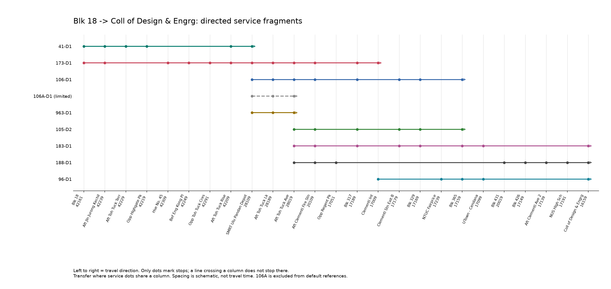

# Blk 18 to Coll of Design & Engrg

This project is an independent research project and is not affiliated with,
endorsed by, or sponsored by the Land Transport Authority of Singapore,
Google, or Citymapper.

## Reference, not a guaranteed trip

Blk 18 (42161) -> Coll of Design & Engrg (16159).
Reference: weekday 10:00 Singapore service-day clock; not a dated timetable or live forecast.
Historical ordered topology and operating windows; every ride/wait/delay below is modeled.
No API calls, scheduled collection, field trip or Google comparison is required or performed.
This is one selected corridor, not a search of every service in Singapore.

Search status: **completed**; complete within declared bounds: True.
Candidates: 7212; eligible for default references: 4558.
Expansions: 24948. Budget: 10000 candidates / 100000 expansions.
Exclusion reasons (overlap possible): {"limited_service_not_default": 2654, "outside_historical_window": 2654}.
Excluded candidates remain in candidates.csv/reference.json. Unknown timing/operation does not erase topology feasibility.
106A is retained only as a limited-service topology alternative, never in the default shortlist or local scoring pool.

## Route references

Mean model minutes, not observed journey times. Delay is separate from waiting and counted once per boarding.
A displayed family merges identical service sequences, not different services; transfer-stop variants remain available below.

| ID | Services | Total | Riding | Waiting | Buffer | Delay | Transfers | Variants |
| --- | --- | ---: | ---: | ---: | ---: | ---: | ---: | ---: |
| R00048 | 173-D1 -> 183-D1 | 42.60 | 21.60 | 15.00 | 3.00 | 3.00 | 1 | 3 |
| R00285 | 173-D1 -> 188-D1 | 42.60 | 21.60 | 15.00 | 3.00 | 3.00 | 1 | 2 |
| R00001 | 173-D1 -> 96-D1 | 43.80 | 22.80 | 15.00 | 3.00 | 3.00 | 1 | 1 |
| R02615 | 41-D1 -> 106-D1 -> 183-D1 | 52.80 | 19.80 | 22.50 | 6.00 | 4.50 | 2 | 6 |
| R02617 | 41-D1 -> 106-D1 -> 96-D1 | 52.80 | 19.80 | 22.50 | 6.00 | 4.50 | 2 | 1 |
| R02696 | 41-D1 -> 106-D1 -> 188-D1 | 52.80 | 19.80 | 22.50 | 6.00 | 4.50 | 2 | 2 |
| R03824 | 41-D1 -> 173-D1 -> 183-D1 | 52.80 | 19.80 | 22.50 | 6.00 | 4.50 | 2 | 9 |
| R04061 | 41-D1 -> 173-D1 -> 188-D1 | 52.80 | 19.80 | 22.50 | 6.00 | 4.50 | 2 | 6 |

### R00048: 173-D1 -> 183-D1

Selected for: estimated_fast, few_transfers, less_wait.

- 173-D1: Blk 18 (42161) -> Blk 317 (17189); ride 13.80 min, wait 7.50, buffer 0.00, delay 1.50.
- 183-D1: Blk 317 (17189) -> Coll of Design & Engrg (16159); ride 7.80 min, wait 7.50, buffer 3.00, delay 1.50.

All 3 eligible transfer-stop variants

| ID | Interchanges (service before transfer) | Total minutes |
| --- | --- | ---: |
| R00048 | 173-D1 at Blk 317 (17189) | 42.60 |
| R00261 | 173-D1 at Aft Toh Tuck Ave (28019) | 42.60 |
| R00131 | 173-D1 at Aft Clementi Fire Stn (20109) | 42.60 |

### R00285: 173-D1 -> 188-D1

Selected for: estimated_fast, few_transfers, less_wait.

- 173-D1: Blk 18 (42161) -> Aft Toh Tuck Ave (28019); ride 10.80 min, wait 7.50, buffer 0.00, delay 1.50.
- 188-D1: Aft Toh Tuck Ave (28019) -> Coll of Design & Engrg (16159); ride 10.80 min, wait 7.50, buffer 3.00, delay 1.50.

All 2 eligible transfer-stop variants

| ID | Interchanges (service before transfer) | Total minutes |
| --- | --- | ---: |
| R00285 | 173-D1 at Aft Toh Tuck Ave (28019) | 42.60 |
| R00146 | 173-D1 at Aft Clementi Fire Stn (20109) | 42.60 |

### R00001: 173-D1 -> 96-D1

Selected for: estimated_fast.

- 173-D1: Blk 18 (42161) -> Clementi Int (17009); ride 14.70 min, wait 7.50, buffer 0.00, delay 1.50.
- 96-D1: Clementi Int (17009) -> Coll of Design & Engrg (16159); ride 8.10 min, wait 7.50, buffer 3.00, delay 1.50.

All 1 eligible transfer-stop variants

| ID | Interchanges (service before transfer) | Total minutes |
| --- | --- | ---: |
| R00001 | 173-D1 at Clementi Int (17009) | 43.80 |

### R02615: 41-D1 -> 106-D1 -> 183-D1

Selected for: estimated_fast.

- 41-D1: Blk 18 (42161) -> SMRT Ulu Pandan Depot (28109); ride 5.70 min, wait 7.50, buffer 0.00, delay 1.50.
- 106-D1: SMRT Ulu Pandan Depot (28109) -> Blk 365 (17159); ride 9.30 min, wait 7.50, buffer 3.00, delay 1.50.
- 183-D1: Blk 365 (17159) -> Coll of Design & Engrg (16159); ride 4.80 min, wait 7.50, buffer 3.00, delay 1.50.

All 6 eligible transfer-stop variants

| ID | Interchanges (service before transfer) | Total minutes |
| --- | --- | ---: |
| R02615 | 41-D1 at SMRT Ulu Pandan Depot (28109); 106-D1 at Blk 365 (17159) | 52.80 |
| R02623 | 41-D1 at SMRT Ulu Pandan Depot (28109); 106-D1 at Blk 329 (17169) | 52.80 |
| R02633 | 41-D1 at SMRT Ulu Pandan Depot (28109); 106-D1 at Clementi Stn Exit B (17179) | 52.80 |
| R02650 | 41-D1 at SMRT Ulu Pandan Depot (28109); 106-D1 at Blk 317 (17189) | 52.80 |
| R02689 | 41-D1 at SMRT Ulu Pandan Depot (28109); 106-D1 at Aft Clementi Fire Stn (20109) | 52.80 |
| R02762 | 41-D1 at SMRT Ulu Pandan Depot (28109); 106-D1 at Aft Toh Tuck Ave (28019) | 52.80 |

### R02617: 41-D1 -> 106-D1 -> 96-D1

Selected for: time_order_fill.

- 41-D1: Blk 18 (42161) -> SMRT Ulu Pandan Depot (28109); ride 5.70 min, wait 7.50, buffer 0.00, delay 1.50.
- 106-D1: SMRT Ulu Pandan Depot (28109) -> Blk 365 (17159); ride 9.30 min, wait 7.50, buffer 3.00, delay 1.50.
- 96-D1: Blk 365 (17159) -> Coll of Design & Engrg (16159); ride 4.80 min, wait 7.50, buffer 3.00, delay 1.50.

All 1 eligible transfer-stop variants

| ID | Interchanges (service before transfer) | Total minutes |
| --- | --- | ---: |
| R02617 | 41-D1 at SMRT Ulu Pandan Depot (28109); 106-D1 at Blk 365 (17159) | 52.80 |

### R02696: 41-D1 -> 106-D1 -> 188-D1

Selected for: time_order_fill.

- 41-D1: Blk 18 (42161) -> SMRT Ulu Pandan Depot (28109); ride 5.70 min, wait 7.50, buffer 0.00, delay 1.50.
- 106-D1: SMRT Ulu Pandan Depot (28109) -> Aft Clementi Fire Stn (20109); ride 5.10 min, wait 7.50, buffer 3.00, delay 1.50.
- 188-D1: Aft Clementi Fire Stn (20109) -> Coll of Design & Engrg (16159); ride 9.00 min, wait 7.50, buffer 3.00, delay 1.50.

All 2 eligible transfer-stop variants

| ID | Interchanges (service before transfer) | Total minutes |
| --- | --- | ---: |
| R02696 | 41-D1 at SMRT Ulu Pandan Depot (28109); 106-D1 at Aft Clementi Fire Stn (20109) | 52.80 |
| R02774 | 41-D1 at SMRT Ulu Pandan Depot (28109); 106-D1 at Aft Toh Tuck Ave (28019) | 52.80 |

### R03824: 41-D1 -> 173-D1 -> 183-D1

Selected for: time_order_fill.

- 41-D1: Blk 18 (42161) -> SMRT Ulu Pandan Depot (28109); ride 5.70 min, wait 7.50, buffer 0.00, delay 1.50.
- 173-D1: SMRT Ulu Pandan Depot (28109) -> Blk 317 (17189); ride 6.30 min, wait 7.50, buffer 3.00, delay 1.50.
- 183-D1: Blk 317 (17189) -> Coll of Design & Engrg (16159); ride 7.80 min, wait 7.50, buffer 3.00, delay 1.50.

All 9 eligible transfer-stop variants

| ID | Interchanges (service before transfer) | Total minutes |
| --- | --- | ---: |
| R03824 | 41-D1 at SMRT Ulu Pandan Depot (28109); 173-D1 at Blk 317 (17189) | 52.80 |
| R04037 | 41-D1 at SMRT Ulu Pandan Depot (28109); 173-D1 at Aft Toh Tuck Ave (28019) | 52.80 |
| R05208 | 41-D1 at Aft Toh Tuck Rise (42209); 173-D1 at Blk 317 (17189) | 52.80 |
| R05421 | 41-D1 at Aft Toh Tuck Rise (42209); 173-D1 at Aft Toh Tuck Ave (28019) | 52.80 |
| R03907 | 41-D1 at SMRT Ulu Pandan Depot (28109); 173-D1 at Aft Clementi Fire Stn (20109) | 52.80 |
| R05291 | 41-D1 at Aft Toh Tuck Rise (42209); 173-D1 at Aft Clementi Fire Stn (20109) | 52.80 |
| R06234 | 41-D1 at Aft Jln Jurong Kechil (42239); 173-D1 at Blk 317 (17189) | 54.60 |
| R06447 | 41-D1 at Aft Jln Jurong Kechil (42239); 173-D1 at Aft Toh Tuck Ave (28019) | 54.60 |
| R06317 | 41-D1 at Aft Jln Jurong Kechil (42239); 173-D1 at Aft Clementi Fire Stn (20109) | 54.60 |

### R04061: 41-D1 -> 173-D1 -> 188-D1

Selected for: time_order_fill.

- 41-D1: Blk 18 (42161) -> SMRT Ulu Pandan Depot (28109); ride 5.70 min, wait 7.50, buffer 0.00, delay 1.50.
- 173-D1: SMRT Ulu Pandan Depot (28109) -> Aft Toh Tuck Ave (28019); ride 3.30 min, wait 7.50, buffer 3.00, delay 1.50.
- 188-D1: Aft Toh Tuck Ave (28019) -> Coll of Design & Engrg (16159); ride 10.80 min, wait 7.50, buffer 3.00, delay 1.50.

All 6 eligible transfer-stop variants

| ID | Interchanges (service before transfer) | Total minutes |
| --- | --- | ---: |
| R04061 | 41-D1 at SMRT Ulu Pandan Depot (28109); 173-D1 at Aft Toh Tuck Ave (28019) | 52.80 |
| R05445 | 41-D1 at Aft Toh Tuck Rise (42209); 173-D1 at Aft Toh Tuck Ave (28019) | 52.80 |
| R03922 | 41-D1 at SMRT Ulu Pandan Depot (28109); 173-D1 at Aft Clementi Fire Stn (20109) | 52.80 |
| R05306 | 41-D1 at Aft Toh Tuck Rise (42209); 173-D1 at Aft Clementi Fire Stn (20109) | 52.80 |
| R06471 | 41-D1 at Aft Jln Jurong Kechil (42239); 173-D1 at Aft Toh Tuck Ave (28019) | 54.60 |
| R06332 | 41-D1 at Aft Jln Jurong Kechil (42239); 173-D1 at Aft Clementi Fire Stn (20109) | 54.60 |

## Along-the-way choices

Every eligible candidate participates, not just the eight displayed families. These local ETA examples are deliberately synthetic.
The full legal history is taken from a searched route. The local clock and arrival offsets are scenario inputs, not reconstructed observations.
The score includes future model waiting and a five-minute transfer penalty; it is NOT an arrival-time prediction.
Future waits use 64 fixed draws (seed 29). No Monte Carlo journey benchmark or catch probability is reported.
Local example status: completed.

### onboard_173_at_depot

At SMRT Ulu Pandan Depot (28109); onboard: 173-D1. Elapsed scenario time: 25 minutes.

| Action | Next stop | Wait incl. buffer | New boarding delay | New transfer | Remaining score |
| --- | --- | ---: | ---: | --- | ---: |
| Board 106-D1 | Aft Toh Tuck Lk (28189) | 3.50 | 1.50 | True | 35.42 |
| Stay on 173-D1 | Aft Toh Tuck Lk (28189) | 0.00 | 0.00 | False | 26.35 |
| Board 963-D1 | Aft Toh Tuck Lk (28189) | 9.00 | 1.50 | True | 44.06 |

Selected: stay on 173-D1

### direct_services_soon

At Aft Toh Tuck Ave (28019); onboard: none (already alighted). Elapsed scenario time: 30 minutes.

| Action | Next stop | Wait incl. buffer | New boarding delay | New transfer | Remaining score |
| --- | --- | ---: | ---: | --- | ---: |
| Board 105-D2 | Aft Clementi Fire Stn (20109) | 8.00 | 1.50 | True | 36.96 |
| Board 106-D1 | Aft Clementi Fire Stn (20109) | 9.00 | 1.50 | True | 37.96 |
| Board 183-D1 | Aft Clementi Fire Stn (20109) | 3.50 | 1.50 | True | 20.80 |
| Board 188-D1 | Aft Clementi Fire Stn (20109) | 4.00 | 1.50 | True | 21.30 |

Selected: board 183-D1

### feeder_services_soon

At Aft Toh Tuck Ave (28019); onboard: none (already alighted). Elapsed scenario time: 30 minutes.

| Action | Next stop | Wait incl. buffer | New boarding delay | New transfer | Remaining score |
| --- | --- | ---: | ---: | --- | ---: |
| Board 105-D2 | Aft Clementi Fire Stn (20109) | 3.50 | 1.50 | True | 32.46 |
| Board 106-D1 | Aft Clementi Fire Stn (20109) | 4.00 | 1.50 | True | 32.96 |
| Board 183-D1 | Aft Clementi Fire Stn (20109) | 21.00 | 1.50 | True | 38.30 |
| Board 188-D1 | Aft Clementi Fire Stn (20109) | 23.00 | 1.50 | True | 40.30 |

Selected: board 105-D2

### onboard_106_at_toh_tuck

At Aft Toh Tuck Ave (28019); onboard: 106-D1. Elapsed scenario time: 30 minutes.

| Action | Next stop | Wait incl. buffer | New boarding delay | New transfer | Remaining score |
| --- | --- | ---: | ---: | --- | ---: |
| Board 105-D2 | Aft Clementi Fire Stn (20109) | 4.00 | 1.50 | True | 32.96 |
| Stay on 106-D1 | Aft Clementi Fire Stn (20109) | 0.00 | 0.00 | False | 22.46 |
| Board 183-D1 | Aft Clementi Fire Stn (20109) | 21.00 | 1.50 | True | 38.30 |
| Board 188-D1 | Aft Clementi Fire Stn (20109) | 23.00 | 1.50 | True | 40.30 |

Selected: stay on 106-D1

### onboard_183_at_blk365

At Blk 365 (17159); onboard: 183-D1. Elapsed scenario time: 45 minutes.

| Action | Next stop | Wait incl. buffer | New boarding delay | New transfer | Remaining score |
| --- | --- | ---: | ---: | --- | ---: |
| Stay on 183-D1 | UTown - Cendana (17099) | 0.00 | 0.00 | False | 4.80 |
| Board 96-D1 | UTown - Cendana (17099) | 3.50 | 1.50 | True | 14.80 |

Selected: stay on 183-D1

## Structure and assumptions

All original intermediate stops are retained; same-stop transfers can occur wherever the fragments meet.
173 may continue through Depot to Aft Toh Tuck Ave or Clementi Int. 106 may stay through to Blk 365.
183 remains onboard through Blk 365 to the destination; continuing does not add waiting, delay or a transfer.
Ride assumption: 20 km/h, >=0.5 min per original segment; headway 15 min; boarding delay Uniform(0,3).
Transfer buffer 3 min; max 5 transfers, 45 min modeled gap, 120 min trip.
Search uses a minimum ride/buffer bound; default eligibility also checks estimated full time and transfer gaps.
These are model constraints, not verified fare rules. Historical windows are checked at each estimated boarding time.
Operating windows do not establish today's availability. Missing/invalid windows remain unknown, not fabricated.
The shared policy uses legal history and current local inputs; recombined paths and future operating windows are not independently validated forecasts.
Ordinary service numbers, not short-working variants, form the default opportunity set; no bonus is assigned just for service count.

## Reproduce

`python -m experiments.blk18_cde_case`

CLI options configure speed, headway, delay, buffer, day/time and search bounds. reference.json records exact settings and frozen source hashes.
candidates.csv/reference.json contain every completed-search candidate. No previous case artifacts are overwritten.
