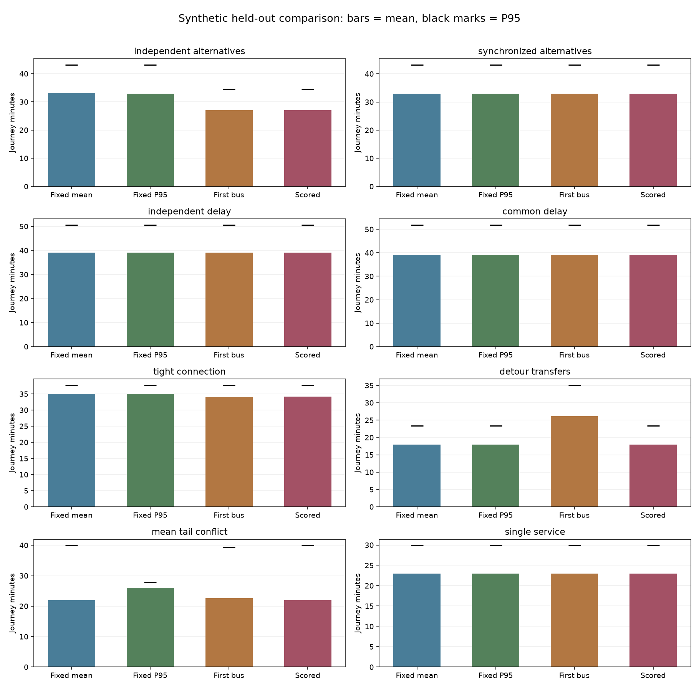

# Fair Synthetic Policy Benchmark

This is an offline controlled experiment, not a forecast for Singapore or a Google comparison.

## Protocol

- Same network, departure time, complete candidate set and immutable held-out worlds per case.
- Graph recombination is audited: every executable complete path must be in the fixed candidate set.
- One executor for fixed, first-eligible and scored policies; identical constraints and cost accounting.
- fixed_mean: select minimum training mean + 5 minutes per transfer, then freeze the route.
- fixed_p95: separately select minimum training P95 (mean breaks ties), then freeze the route.
- first_eligible: earliest feasible local departure; remain onboard on equal-time ties.
- suffix_scored: existing SharedSuffixPolicy, stationary remaining mean + transfer penalty.
- No test-world route selection, retrospective best route, future realized delay, or remote API.
- Quantiles use the nearest-rank empirical definition; a trip that cannot finish has infinite duration.
- Infinite metrics become null in JSON, with completion and conditional completed means retained.

## Held-Out Results

| Case | Strategy | Mean | P90 | P95 | Station wait | P(transfer wait >10m) | Transfers | Completed |
| --- | --- | ---: | ---: | ---: | ---: | ---: | ---: | ---: |
| independent_alternatives | fixed_mean | 33.04 | 41.41 | 43.16 | 14.04 | 0.50 | 1.00 | 1.00 |
| independent_alternatives | fixed_p95 | 32.90 | 41.38 | 43.16 | 13.91 | 0.49 | 1.00 | 1.00 |
| independent_alternatives | first_eligible | 27.02 | 32.47 | 34.49 | 8.03 | 0.06 | 1.00 | 1.00 |
| independent_alternatives | suffix_scored | 27.02 | 32.47 | 34.49 | 8.03 | 0.06 | 1.00 | 1.00 |
| synchronized_alternatives | fixed_mean | 33.00 | 41.53 | 43.23 | 14.00 | 0.50 | 1.00 | 1.00 |
| synchronized_alternatives | fixed_p95 | 33.00 | 41.53 | 43.23 | 14.00 | 0.50 | 1.00 | 1.00 |
| synchronized_alternatives | first_eligible | 33.00 | 41.53 | 43.23 | 14.00 | 0.50 | 1.00 | 1.00 |
| synchronized_alternatives | suffix_scored | 33.00 | 41.53 | 43.23 | 14.00 | 0.50 | 1.00 | 1.00 |
| independent_delay | fixed_mean | 39.14 | 48.50 | 50.57 | 14.15 | 0.51 | 1.00 | 1.00 |
| independent_delay | fixed_p95 | 39.14 | 48.50 | 50.57 | 14.15 | 0.51 | 1.00 | 1.00 |
| independent_delay | first_eligible | 39.14 | 48.40 | 50.53 | 14.15 | 0.51 | 1.00 | 1.00 |
| independent_delay | suffix_scored | 39.14 | 48.40 | 50.53 | 14.15 | 0.51 | 1.00 | 1.00 |
| common_delay | fixed_mean | 39.04 | 49.51 | 51.85 | 14.07 | 0.51 | 1.00 | 1.00 |
| common_delay | fixed_p95 | 39.04 | 49.51 | 51.85 | 14.07 | 0.51 | 1.00 | 1.00 |
| common_delay | first_eligible | 39.04 | 49.51 | 51.85 | 14.07 | 0.51 | 1.00 | 1.00 |
| common_delay | suffix_scored | 39.04 | 49.51 | 51.85 | 14.07 | 0.51 | 1.00 | 1.00 |
| tight_connection | fixed_mean | 35.02 | 37.42 | 37.71 | 3.02 | 0.00 | 0.00 | 1.00 |
| tight_connection | fixed_p95 | 35.02 | 37.42 | 37.71 | 3.02 | 0.00 | 0.00 | 1.00 |
| tight_connection | first_eligible | 34.08 | 37.27 | 37.71 | 3.45 | 0.00 | 0.20 | 1.00 |
| tight_connection | suffix_scored | 34.18 | 37.20 | 37.62 | 3.31 | 0.02 | 0.16 | 1.00 |
| detour_transfers | fixed_mean | 17.98 | 22.75 | 23.35 | 5.98 | 0.00 | 0.00 | 1.00 |
| detour_transfers | fixed_p95 | 17.98 | 22.75 | 23.35 | 5.98 | 0.00 | 0.00 | 1.00 |
| detour_transfers | first_eligible | 26.15 | 34.23 | 35.07 | 5.22 | 0.00 | 1.49 | 1.00 |
| detour_transfers | suffix_scored | 17.98 | 22.75 | 23.35 | 5.98 | 0.00 | 0.00 | 1.00 |
| mean_tail_conflict | fixed_mean | 21.98 | 38.07 | 39.97 | 1.00 | 0.00 | 0.00 | 1.00 |
| mean_tail_conflict | fixed_p95 | 26.01 | 27.61 | 27.80 | 2.01 | 0.00 | 0.00 | 1.00 |
| mean_tail_conflict | first_eligible | 22.57 | 36.83 | 39.28 | 0.84 | 0.00 | 0.00 | 1.00 |
| mean_tail_conflict | suffix_scored | 21.98 | 38.07 | 39.97 | 1.00 | 0.00 | 0.00 | 1.00 |
| single_service | fixed_mean | 22.95 | 29.02 | 29.91 | 7.45 | 0.00 | 0.00 | 1.00 |
| single_service | fixed_p95 | 22.95 | 29.02 | 29.91 | 7.45 | 0.00 | 0.00 | 1.00 |
| single_service | first_eligible | 22.95 | 29.02 | 29.91 | 7.45 | 0.00 | 0.00 | 1.00 |
| single_service | suffix_scored | 22.95 | 29.02 | 29.91 | 7.45 | 0.00 | 0.00 | 1.00 |

Station wait excludes the transfer buffer; both are recorded separately in the sample files.
For incomplete trips, wait/transfer counts are observed prefixes and long-wait risk is bounded, not imputed.

## Paired Comparisons

Differences are scored minus comparator; negative means lower modeled journey time.
Intervals measure Monte Carlo sampling uncertainty only and are not adjusted for multiple comparisons.

| Case | Comparator | Mean delta [95% interval] | P95 delta [95% interval] |
| --- | --- | --- | --- |
| independent_alternatives | fixed_mean | -6.02 [-6.13, -5.91] | -8.68 [-8.92, -8.48] |
| independent_alternatives | fixed_p95 | -5.88 [-5.99, -5.77] | -8.68 [-8.95, -8.45] |
| independent_alternatives | first_eligible | 0.00 [0.00, 0.00] | 0.00 [0.00, 0.00] |
| synchronized_alternatives | fixed_mean | 0.00 [0.00, 0.00] | 0.00 [0.00, 0.00] |
| synchronized_alternatives | fixed_p95 | 0.00 [0.00, 0.00] | 0.00 [0.00, 0.00] |
| synchronized_alternatives | first_eligible | 0.00 [0.00, 0.00] | 0.00 [0.00, 0.00] |
| independent_delay | fixed_mean | -0.01 [-0.07, 0.06] | -0.04 [-0.25, 0.26] |
| independent_delay | fixed_p95 | -0.01 [-0.07, 0.06] | -0.04 [-0.25, 0.26] |
| independent_delay | first_eligible | 0.00 [0.00, 0.00] | 0.00 [0.00, 0.00] |
| common_delay | fixed_mean | 0.00 [0.00, 0.00] | 0.00 [0.00, 0.00] |
| common_delay | fixed_p95 | 0.00 [0.00, 0.00] | 0.00 [0.00, 0.00] |
| common_delay | first_eligible | 0.00 [0.00, 0.00] | 0.00 [0.00, 0.00] |
| tight_connection | fixed_mean | -0.84 [-0.90, -0.79] | -0.09 [-0.11, -0.07] |
| tight_connection | fixed_p95 | -0.84 [-0.90, -0.79] | -0.09 [-0.11, -0.07] |
| tight_connection | first_eligible | 0.09 [0.07, 0.12] | -0.09 [-0.12, -0.07] |
| detour_transfers | fixed_mean | 0.00 [0.00, 0.00] | 0.00 [0.00, 0.00] |
| detour_transfers | fixed_p95 | 0.00 [0.00, 0.00] | 0.00 [0.00, 0.00] |
| detour_transfers | first_eligible | -8.17 [-8.30, -8.04] | -11.72 [-11.84, -11.63] |
| mean_tail_conflict | fixed_mean | 0.00 [0.00, 0.00] | 0.00 [0.00, 0.00] |
| mean_tail_conflict | fixed_p95 | -4.03 [-4.26, -3.80] | 12.18 [11.97, 12.32] |
| mean_tail_conflict | first_eligible | -0.60 [-0.71, -0.48] | 0.70 [0.54, 0.85] |
| single_service | fixed_mean | 0.00 [0.00, 0.00] | 0.00 [0.00, 0.00] |
| single_service | fixed_p95 | 0.00 [0.00, 0.00] | 0.00 [0.00, 0.00] |
| single_service | first_eligible | 0.00 [0.00, 0.00] | 0.00 [0.00, 0.00] |



## Diagnostic

Pre-specified feeder-to-connection fixed path: nominal miss rate 0.832, mean 39.98, P95 49.04 minutes.
With delay Uniform(0,6) and one minute of slack, its analytic miss probability is 5/6.
This diagnostic is not a retrospectively selected comparator; the main fixed baselines may
select the direct route during training, which is a legitimate response to connection risk.


## Diagnostic

Pre-specified feeder-to-connection fixed path: nominal miss rate 0.832, mean 39.98, P95 49.04 minutes.
With delay Uniform(0,6) and one minute of slack, its analytic miss probability is 5/6.
This diagnostic is not a retrospectively selected comparator; the main fixed baselines may
select the direct route during training, which is a legitimate response to connection risk.


## Controls and Limitations

Independent and synchronized alternatives use identical topology and marginal time distributions.
Synchronized tails share phases and delays: four service labels need not provide four independent chances.
independent_delay and common_delay both have synchronized tail phases and eight-minute delay bounds.
Only delay dependence changes: independent shocks versus one common shock across services. Neither
is a physical congestion/bunching model, and this pair is separate from the low-delay phase controls.
tight_connection has one minute of nominal transfer slack after the three-minute buffer; feeder delay
can miss that bus. Its miss diagnostic compares actual readiness with a no-delay nominal clock along
the selected path; it is not a measured catch probability or evidence against a published timetable.
detour_transfers tests the cost of taking an early bus that creates extra riding or transfers.
mean_tail_conflict is deliberately adverse to mean optimization: a faster-mean route has a heavy tail.
single_service is a no-choice control; all controllers must agree sample by sample.
No scenario is removed because adaptive performance is equal or worse.

Local next departures are perfect observations; downstream waits in the value function remain stationary
and independent even in correlated test worlds. No learned adaptation to these correlations is claimed.
Periodic schedules have random initial phases. Delay is charged once on boarding and retained while
onboard, not at every stop. This is a passenger-level cost model, not a consistent multi-bus fleet model.
No walking access, road network, actual fares, live ETA errors, capacity limits or passenger observations.
The existing scorer does not directly optimize P95 or outdoor comfort. The P95-selected fixed control
prevents lower mean time being mislabeled as universal tail-risk superiority.

## Reproduction

```powershell
python -m experiments.fair_benchmark
```

Install the project first: `python -m pip install -e ".[dev]"`. No credentials are required.
Default: 2,000 training worlds, 10,000 held-out worlds per case; training seed 7001, test seed 9001,
stationary-value seed 29 (64 draws), paired-bootstrap seed 811 (300 resamples).
JSON contains actual counts/seeds/configurations, all training scores, selected routes, graph audit,
candidate/world hashes, and every comparison. NPZ files contain paired sample arrays; summary.csv
is a compact table. Each NPZ index refers to the same world across strategies within its case.

This project is an independent research project and is not affiliated with,
endorsed by, or sponsored by the Land Transport Authority of Singapore, Google, or Citymapper.
