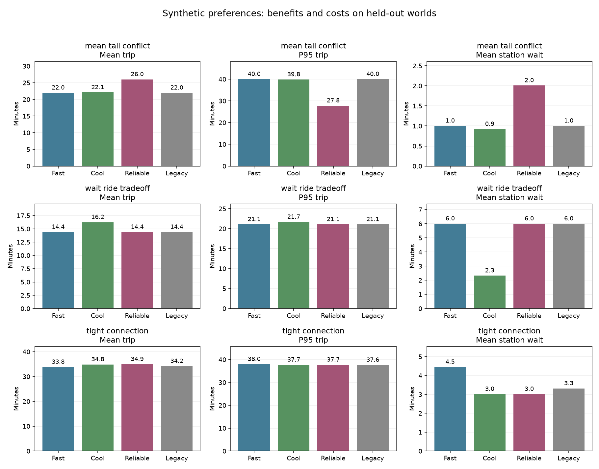

# Preference-Aware Routing Experiment

Synthetic, offline, stop-to-stop research. No LTA or Google calls or real journey predictions.

## Decision Rules

All modes first minimize estimated noncompletion probability, then their objective:
- fast: mean remaining duration.
- cool: mean duration + extra_wait_weight * mean station wait + transfer_penalty * transfers.
  Defaults are 2 and 3: waiting already in duration has a total weight of 3. These are declared
  scenario preferences, not empirically learned comfort values. JSON stores the actual settings.
- reliable: nearest-rank P95 duration; mean and transfers break ties.

Fixed routes are selected on training outcomes and frozen before testing. Dynamic modes score
each complete legal fixed suffix using model distributions, choose one before realization, execute
only its first arc, then replan. There is no per-draw selection of the best future route.
Future waits/delays use independent stationary stratified uniform draws, separate from test data.
Only local next departures are observed. Remaining onboard incurs no extra wait, delay or transfer.
This is bounded distributional lookahead, not a globally optimal or time-consistent P95 policy.

## Held-Out Results

| Case | Strategy | Mean | P95 | Station wait | P(transfer wait >10m) | Transfers | Completion |
| --- | --- | ---: | ---: | ---: | ---: | ---: | ---: |
| independent_alternatives | fixed_fast | 33.04 | 43.16 | 14.04 | 0.50 | 1.00 | 1.00 |
| independent_alternatives | fixed_cool | 33.04 | 43.16 | 14.04 | 0.50 | 1.00 | 1.00 |
| independent_alternatives | fixed_reliable | 32.90 | 43.16 | 13.91 | 0.49 | 1.00 | 1.00 |
| independent_alternatives | dynamic_fast | 27.02 | 34.49 | 8.03 | 0.06 | 1.00 | 1.00 |
| independent_alternatives | dynamic_cool | 27.02 | 34.49 | 8.03 | 0.06 | 1.00 | 1.00 |
| independent_alternatives | dynamic_reliable | 27.02 | 34.49 | 8.03 | 0.06 | 1.00 | 1.00 |
| independent_alternatives | first_eligible | 27.02 | 34.49 | 8.03 | 0.06 | 1.00 | 1.00 |
| independent_alternatives | legacy_scored | 27.02 | 34.49 | 8.03 | 0.06 | 1.00 | 1.00 |
| synchronized_alternatives | fixed_fast | 33.00 | 43.23 | 14.00 | 0.50 | 1.00 | 1.00 |
| synchronized_alternatives | fixed_cool | 33.00 | 43.23 | 14.00 | 0.50 | 1.00 | 1.00 |
| synchronized_alternatives | fixed_reliable | 33.00 | 43.23 | 14.00 | 0.50 | 1.00 | 1.00 |
| synchronized_alternatives | dynamic_fast | 33.00 | 43.23 | 14.00 | 0.50 | 1.00 | 1.00 |
| synchronized_alternatives | dynamic_cool | 33.00 | 43.23 | 14.00 | 0.50 | 1.00 | 1.00 |
| synchronized_alternatives | dynamic_reliable | 33.00 | 43.23 | 14.00 | 0.50 | 1.00 | 1.00 |
| synchronized_alternatives | first_eligible | 33.00 | 43.23 | 14.00 | 0.50 | 1.00 | 1.00 |
| synchronized_alternatives | legacy_scored | 33.00 | 43.23 | 14.00 | 0.50 | 1.00 | 1.00 |
| independent_delay | fixed_fast | 39.14 | 50.57 | 14.15 | 0.51 | 1.00 | 1.00 |
| independent_delay | fixed_cool | 39.14 | 50.57 | 14.15 | 0.51 | 1.00 | 1.00 |
| independent_delay | fixed_reliable | 39.14 | 50.57 | 14.15 | 0.51 | 1.00 | 1.00 |
| independent_delay | dynamic_fast | 39.14 | 50.55 | 14.15 | 0.51 | 1.00 | 1.00 |
| independent_delay | dynamic_cool | 39.14 | 50.55 | 14.15 | 0.51 | 1.00 | 1.00 |
| independent_delay | dynamic_reliable | 39.14 | 50.55 | 14.15 | 0.51 | 1.00 | 1.00 |
| independent_delay | first_eligible | 39.14 | 50.53 | 14.15 | 0.51 | 1.00 | 1.00 |
| independent_delay | legacy_scored | 39.14 | 50.53 | 14.15 | 0.51 | 1.00 | 1.00 |
| common_delay | fixed_fast | 39.04 | 51.85 | 14.07 | 0.51 | 1.00 | 1.00 |
| common_delay | fixed_cool | 39.04 | 51.85 | 14.07 | 0.51 | 1.00 | 1.00 |
| common_delay | fixed_reliable | 39.04 | 51.85 | 14.07 | 0.51 | 1.00 | 1.00 |
| common_delay | dynamic_fast | 39.04 | 51.85 | 14.07 | 0.51 | 1.00 | 1.00 |
| common_delay | dynamic_cool | 39.04 | 51.85 | 14.07 | 0.51 | 1.00 | 1.00 |
| common_delay | dynamic_reliable | 39.04 | 51.85 | 14.07 | 0.51 | 1.00 | 1.00 |
| common_delay | first_eligible | 39.04 | 51.85 | 14.07 | 0.51 | 1.00 | 1.00 |
| common_delay | legacy_scored | 39.04 | 51.85 | 14.07 | 0.51 | 1.00 | 1.00 |
| tight_connection | fixed_fast | 35.02 | 37.71 | 3.02 | 0.00 | 0.00 | 1.00 |
| tight_connection | fixed_cool | 35.02 | 37.71 | 3.02 | 0.00 | 0.00 | 1.00 |
| tight_connection | fixed_reliable | 35.02 | 37.71 | 3.02 | 0.00 | 0.00 | 1.00 |
| tight_connection | dynamic_fast | 33.83 | 37.95 | 4.45 | 0.04 | 0.37 | 1.00 |
| tight_connection | dynamic_cool | 34.85 | 37.67 | 3.02 | 0.00 | 0.02 | 1.00 |
| tight_connection | dynamic_reliable | 34.94 | 37.68 | 3.02 | 0.00 | 0.01 | 1.00 |
| tight_connection | first_eligible | 34.08 | 37.71 | 3.45 | 0.00 | 0.20 | 1.00 |
| tight_connection | legacy_scored | 34.18 | 37.62 | 3.31 | 0.02 | 0.16 | 1.00 |
| detour_transfers | fixed_fast | 17.98 | 23.35 | 5.98 | 0.00 | 0.00 | 1.00 |
| detour_transfers | fixed_cool | 17.98 | 23.35 | 5.98 | 0.00 | 0.00 | 1.00 |
| detour_transfers | fixed_reliable | 17.98 | 23.35 | 5.98 | 0.00 | 0.00 | 1.00 |
| detour_transfers | dynamic_fast | 17.98 | 23.35 | 5.65 | 0.00 | 0.17 | 1.00 |
| detour_transfers | dynamic_cool | 18.04 | 23.43 | 5.55 | 0.00 | 0.20 | 1.00 |
| detour_transfers | dynamic_reliable | 17.98 | 23.35 | 5.98 | 0.00 | 0.00 | 1.00 |
| detour_transfers | first_eligible | 26.15 | 35.07 | 5.22 | 0.00 | 1.49 | 1.00 |
| detour_transfers | legacy_scored | 17.98 | 23.35 | 5.98 | 0.00 | 0.00 | 1.00 |
| mean_tail_conflict | fixed_fast | 21.98 | 39.97 | 1.00 | 0.00 | 0.00 | 1.00 |
| mean_tail_conflict | fixed_cool | 21.98 | 39.97 | 1.00 | 0.00 | 0.00 | 1.00 |
| mean_tail_conflict | fixed_reliable | 26.01 | 27.80 | 2.01 | 0.00 | 0.00 | 1.00 |
| mean_tail_conflict | dynamic_fast | 21.98 | 39.97 | 1.00 | 0.00 | 0.00 | 1.00 |
| mean_tail_conflict | dynamic_cool | 22.09 | 39.82 | 0.92 | 0.00 | 0.00 | 1.00 |
| mean_tail_conflict | dynamic_reliable | 26.01 | 27.80 | 2.01 | 0.00 | 0.00 | 1.00 |
| mean_tail_conflict | first_eligible | 22.57 | 39.28 | 0.84 | 0.00 | 0.00 | 1.00 |
| mean_tail_conflict | legacy_scored | 21.98 | 39.97 | 1.00 | 0.00 | 0.00 | 1.00 |
| single_service | fixed_fast | 22.95 | 29.91 | 7.45 | 0.00 | 0.00 | 1.00 |
| single_service | fixed_cool | 22.95 | 29.91 | 7.45 | 0.00 | 0.00 | 1.00 |
| single_service | fixed_reliable | 22.95 | 29.91 | 7.45 | 0.00 | 0.00 | 1.00 |
| single_service | dynamic_fast | 22.95 | 29.91 | 7.45 | 0.00 | 0.00 | 1.00 |
| single_service | dynamic_cool | 22.95 | 29.91 | 7.45 | 0.00 | 0.00 | 1.00 |
| single_service | dynamic_reliable | 22.95 | 29.91 | 7.45 | 0.00 | 0.00 | 1.00 |
| single_service | first_eligible | 22.95 | 29.91 | 7.45 | 0.00 | 0.00 | 1.00 |
| single_service | legacy_scored | 22.95 | 29.91 | 7.45 | 0.00 | 0.00 | 1.00 |
| wait_ride_tradeoff | fixed_fast | 15.08 | 24.07 | 10.08 | 0.00 | 0.00 | 1.00 |
| wait_ride_tradeoff | fixed_cool | 19.99 | 21.80 | 1.99 | 0.00 | 0.00 | 1.00 |
| wait_ride_tradeoff | fixed_reliable | 19.99 | 21.80 | 1.99 | 0.00 | 0.00 | 1.00 |
| wait_ride_tradeoff | dynamic_fast | 14.39 | 21.06 | 6.00 | 0.00 | 0.00 | 1.00 |
| wait_ride_tradeoff | dynamic_cool | 16.24 | 21.66 | 2.32 | 0.00 | 0.00 | 1.00 |
| wait_ride_tradeoff | dynamic_reliable | 14.39 | 21.06 | 6.00 | 0.00 | 0.00 | 1.00 |
| wait_ride_tradeoff | first_eligible | 18.54 | 21.74 | 1.86 | 0.00 | 0.00 | 1.00 |
| wait_ride_tradeoff | legacy_scored | 14.39 | 21.06 | 6.00 | 0.00 | 0.00 | 1.00 |

## Comfort Tradeoffs

Dynamic cool minus dynamic fast. Negative means lower; extra travel time is not hidden.

| Case | Total time delta | Station wait delta | Transfer delta |
| --- | ---: | ---: | ---: |
| independent_alternatives | 0.00 | 0.00 | 0.00 |
| synchronized_alternatives | 0.00 | 0.00 | 0.00 |
| independent_delay | 0.00 | 0.00 | 0.00 |
| common_delay | 0.00 | 0.00 | 0.00 |
| tight_connection | 1.02 | -1.44 | -0.34 |
| detour_transfers | 0.06 | -0.11 | 0.04 |
| mean_tail_conflict | 0.12 | -0.08 | 0.00 |
| single_service | 0.00 | 0.00 | 0.00 |
| wait_ride_tradeoff | 1.84 | -3.68 | 0.00 |

## Paired Uncertainty

Differences are within-world comparisons. Approximate 95% mean intervals and paired bootstrap
P95 intervals measure Monte Carlo uncertainty conditional on the synthetic model and trained choice.
They do not include model error, policy selection uncertainty or multiple-comparison correction.

| Case | Difference | Mean [95% interval] | P95 [95% interval] |
| --- | --- | --- | --- |
| independent_alternatives | dynamic_fast_minus_fixed_fast | -6.02 [-6.13, -5.91] | -8.68 [-8.92, -8.48] |
| independent_alternatives | dynamic_cool_minus_fixed_cool | -6.02 [-6.13, -5.91] | -8.68 [-8.92, -8.48] |
| independent_alternatives | dynamic_reliable_minus_fixed_reliable | -5.88 [-5.99, -5.77] | -8.68 [-8.95, -8.45] |
| independent_alternatives | dynamic_cool_minus_dynamic_fast | 0.00 [0.00, 0.00] | 0.00 [0.00, 0.00] |
| independent_alternatives | dynamic_reliable_minus_dynamic_fast | 0.00 [0.00, 0.00] | 0.00 [0.00, 0.00] |
| independent_alternatives | dynamic_reliable_minus_legacy_scored | 0.00 [0.00, 0.00] | 0.00 [0.00, 0.00] |
| independent_alternatives | dynamic_fast_minus_first_eligible | 0.00 [0.00, 0.00] | 0.00 [0.00, 0.00] |
| synchronized_alternatives | dynamic_fast_minus_fixed_fast | 0.00 [0.00, 0.00] | 0.00 [0.00, 0.00] |
| synchronized_alternatives | dynamic_cool_minus_fixed_cool | 0.00 [0.00, 0.00] | 0.00 [0.00, 0.00] |
| synchronized_alternatives | dynamic_reliable_minus_fixed_reliable | 0.00 [0.00, 0.00] | 0.00 [0.00, 0.00] |
| synchronized_alternatives | dynamic_cool_minus_dynamic_fast | 0.00 [0.00, 0.00] | 0.00 [0.00, 0.00] |
| synchronized_alternatives | dynamic_reliable_minus_dynamic_fast | 0.00 [0.00, 0.00] | 0.00 [0.00, 0.00] |
| synchronized_alternatives | dynamic_reliable_minus_legacy_scored | 0.00 [0.00, 0.00] | 0.00 [0.00, 0.00] |
| synchronized_alternatives | dynamic_fast_minus_first_eligible | 0.00 [0.00, 0.00] | 0.00 [0.00, 0.00] |
| independent_delay | dynamic_fast_minus_fixed_fast | -0.01 [-0.07, 0.06] | -0.02 [-0.23, 0.26] |
| independent_delay | dynamic_cool_minus_fixed_cool | -0.01 [-0.07, 0.06] | -0.02 [-0.23, 0.26] |
| independent_delay | dynamic_reliable_minus_fixed_reliable | -0.01 [-0.07, 0.06] | -0.02 [-0.23, 0.26] |
| independent_delay | dynamic_cool_minus_dynamic_fast | 0.00 [0.00, 0.00] | 0.00 [0.00, 0.00] |
| independent_delay | dynamic_reliable_minus_dynamic_fast | 0.00 [0.00, 0.00] | 0.00 [0.00, 0.00] |
| independent_delay | dynamic_reliable_minus_legacy_scored | 0.00 [-0.01, 0.01] | 0.02 [-0.02, 0.07] |
| independent_delay | dynamic_fast_minus_first_eligible | 0.00 [-0.01, 0.01] | 0.02 [-0.02, 0.07] |
| common_delay | dynamic_fast_minus_fixed_fast | 0.00 [0.00, 0.00] | 0.00 [0.00, 0.00] |
| common_delay | dynamic_cool_minus_fixed_cool | 0.00 [0.00, 0.00] | 0.00 [0.00, 0.00] |
| common_delay | dynamic_reliable_minus_fixed_reliable | 0.00 [0.00, 0.00] | 0.00 [0.00, 0.00] |
| common_delay | dynamic_cool_minus_dynamic_fast | 0.00 [0.00, 0.00] | 0.00 [0.00, 0.00] |
| common_delay | dynamic_reliable_minus_dynamic_fast | 0.00 [0.00, 0.00] | 0.00 [0.00, 0.00] |
| common_delay | dynamic_reliable_minus_legacy_scored | 0.00 [0.00, 0.00] | 0.00 [0.00, 0.00] |
| common_delay | dynamic_fast_minus_first_eligible | 0.00 [0.00, 0.00] | 0.00 [0.00, 0.00] |
| tight_connection | dynamic_fast_minus_fixed_fast | -1.19 [-1.26, -1.12] | 0.25 [0.20, 0.31] |
| tight_connection | dynamic_cool_minus_fixed_cool | -0.17 [-0.20, -0.15] | -0.04 [-0.06, -0.03] |
| tight_connection | dynamic_reliable_minus_fixed_reliable | -0.08 [-0.10, -0.06] | -0.02 [-0.03, -0.01] |
| tight_connection | dynamic_cool_minus_dynamic_fast | 1.02 [0.95, 1.08] | -0.29 [-0.35, -0.25] |
| tight_connection | dynamic_reliable_minus_dynamic_fast | 1.11 [1.04, 1.18] | -0.27 [-0.34, -0.23] |
| tight_connection | dynamic_reliable_minus_legacy_scored | 0.76 [0.71, 0.82] | 0.07 [0.05, 0.09] |
| tight_connection | dynamic_fast_minus_first_eligible | -0.25 [-0.29, -0.21] | 0.24 [0.20, 0.30] |
| detour_transfers | dynamic_fast_minus_fixed_fast | 0.00 [0.00, 0.00] | 0.00 [0.00, 0.00] |
| detour_transfers | dynamic_cool_minus_fixed_cool | 0.06 [0.05, 0.07] | 0.08 [0.04, 0.11] |
| detour_transfers | dynamic_reliable_minus_fixed_reliable | 0.00 [0.00, 0.00] | 0.00 [0.00, 0.00] |
| detour_transfers | dynamic_cool_minus_dynamic_fast | 0.06 [0.05, 0.07] | 0.08 [0.04, 0.11] |
| detour_transfers | dynamic_reliable_minus_dynamic_fast | 0.00 [0.00, 0.00] | 0.00 [0.00, 0.00] |
| detour_transfers | dynamic_reliable_minus_legacy_scored | 0.00 [0.00, 0.00] | 0.00 [0.00, 0.00] |
| detour_transfers | dynamic_fast_minus_first_eligible | -8.17 [-8.30, -8.04] | -11.72 [-11.84, -11.63] |
| mean_tail_conflict | dynamic_fast_minus_fixed_fast | 0.00 [0.00, 0.00] | 0.00 [0.00, 0.00] |
| mean_tail_conflict | dynamic_cool_minus_fixed_cool | 0.12 [0.06, 0.17] | -0.16 [-0.22, -0.07] |
| mean_tail_conflict | dynamic_reliable_minus_fixed_reliable | 0.00 [0.00, 0.00] | 0.00 [0.00, 0.00] |
| mean_tail_conflict | dynamic_cool_minus_dynamic_fast | 0.12 [0.06, 0.17] | -0.16 [-0.22, -0.07] |
| mean_tail_conflict | dynamic_reliable_minus_dynamic_fast | 4.03 [3.80, 4.26] | -12.18 [-12.32, -11.97] |
| mean_tail_conflict | dynamic_reliable_minus_legacy_scored | 4.03 [3.80, 4.26] | -12.18 [-12.32, -11.97] |
| mean_tail_conflict | dynamic_fast_minus_first_eligible | -0.60 [-0.71, -0.48] | 0.70 [0.54, 0.85] |
| single_service | dynamic_fast_minus_fixed_fast | 0.00 [0.00, 0.00] | 0.00 [0.00, 0.00] |
| single_service | dynamic_cool_minus_fixed_cool | 0.00 [0.00, 0.00] | 0.00 [0.00, 0.00] |
| single_service | dynamic_reliable_minus_fixed_reliable | 0.00 [0.00, 0.00] | 0.00 [0.00, 0.00] |
| single_service | dynamic_cool_minus_dynamic_fast | 0.00 [0.00, 0.00] | 0.00 [0.00, 0.00] |
| single_service | dynamic_reliable_minus_dynamic_fast | 0.00 [0.00, 0.00] | 0.00 [0.00, 0.00] |
| single_service | dynamic_reliable_minus_legacy_scored | 0.00 [0.00, 0.00] | 0.00 [0.00, 0.00] |
| single_service | dynamic_fast_minus_first_eligible | 0.00 [0.00, 0.00] | 0.00 [0.00, 0.00] |
| wait_ride_tradeoff | dynamic_fast_minus_fixed_fast | -0.68 [-0.71, -0.65] | -3.01 [-3.08, -2.91] |
| wait_ride_tradeoff | dynamic_cool_minus_fixed_cool | -3.75 [-3.86, -3.64] | -0.13 [-0.15, -0.11] |
| wait_ride_tradeoff | dynamic_reliable_minus_fixed_reliable | -5.60 [-5.70, -5.50] | -0.73 [-0.79, -0.67] |
| wait_ride_tradeoff | dynamic_cool_minus_dynamic_fast | 1.84 [1.79, 1.90] | 0.60 [0.54, 0.66] |
| wait_ride_tradeoff | dynamic_reliable_minus_dynamic_fast | 0.00 [0.00, 0.00] | 0.00 [0.00, 0.00] |
| wait_ride_tradeoff | dynamic_reliable_minus_legacy_scored | 0.00 [0.00, 0.00] | 0.00 [0.00, 0.00] |
| wait_ride_tradeoff | dynamic_fast_minus_first_eligible | -4.14 [-4.23, -4.06] | -0.67 [-0.73, -0.61] |



The figure highlights three diagnostic cases; all nine cases and eight strategy labels are
retained above, including ties and regressions.

## Observed Boundaries

In tight_connection, reliable P95 is 37.68 minutes versus legacy_scored 37.62.
Reliable targets its projected suffix distribution; it does not guarantee beating the old
heuristic once the future model is misspecified and choices are replanned.

In detour_transfers, cool minus fast changes mean time by 0.06, mean wait by -0.11, and mean transfers by 0.04.
Lower waiting can come with extra transfers despite their configured penalty. Transfer buffers
are not counted as station waiting; this is not a validated outdoor heat-exposure model.


## Limits and Reproduction

All eight prior regression cases are retained, plus a declared wait-versus-ride control.
Correlation and tight-connection cases deliberately violate the dynamic stationary independent
future model; training-fixed selection sees those scenarios, dynamic rollouts do not learn them.
This information/model difference is explicit: the comparison does not isolate preference weights
from model approximation. Compare the three new dynamic modes to isolate their preference effects.
legacy_scored uses its existing stationary mean + 5-per-transfer heuristic, not the new fast rule.
More branches are useful only when their times and downstream costs are useful. Negative outcomes
remain in these tables. No preference promises universal improvements on every metric.

Wait excludes the separately recorded transfer buffer. Incomplete journeys keep infinite duration
(JSON null); recorded waits/counts are prefixes and long-wait risk is bounded, not filled as success.
No walking access, capacity limits, live ETA errors, actual fares or actual catch probabilities.
The cool objective penalizes expected wait, not directly P(wait >10m); that probability is reported.
The reliable mode optimizes a conditional suffix percentile; replanning can change the final mixture
and need not reduce the overall journey P95. Limits and no-choice cases are retained.

```powershell
python -m experiments.preference_benchmark
```

Default: 2,000 training worlds (seed 7001), 10,000 held-out worlds (9001), 256 rollout draws (2309).
Legacy value seed 29; bootstrap seed 811, 300 resamples. Actual settings and source hashes are in JSON.
Each NPZ sample index is the same test world across all strategy labels. No credentials required.

This project is an independent research project and is not affiliated with, endorsed by, or sponsored
by the Land Transport Authority of Singapore, Google, or Citymapper.
